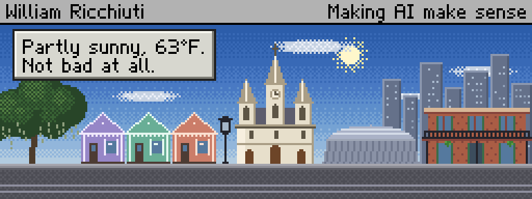

  

Independent developer in New Orleans. I build AI tools and explain them to people who don't live in code.

🌐 [william-ricchiuti.com](https://william-ricchiuti.com)

The header is real pixel art (256×96, VGA colors) redrawn every hour from the National Weather Service forecast for New Orleans.
